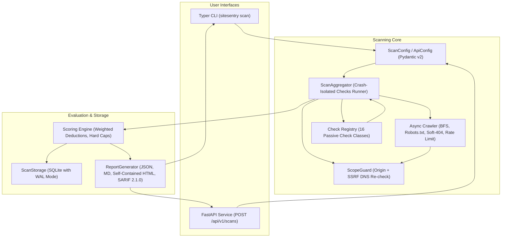

# SiteSentry Architecture

SiteSentry is an asynchronous, passive web security auditing tool built with Python 3.11+. Both the Typer CLI and the FastAPI HTTP service share a unified scanning, scoring, and reporting pipeline.

---

## 1. System Overview

---

## 2. Component Breakdown

### 2.1 ScopeGuard & SSRF Defense (`scope.py`)
To prevent Server-Side Request Forgery (SSRF), SiteSentry verifies URLs at multiple points:
1. **Origin Verification:** Only the target URL's registrable origin (`scheme://host[:port]`) is crawled. Redirects outside this origin are reported as non-crawled transitions.
2. **IP Range Restrictions:** Rejects requests resolving to loopback (`127.0.0.0/8`, `::1`), RFC 1918 private ranges (`10.0.0.0/8`, `172.16.0.0/12`, `192.168.0.0/16`), link-local/cloud metadata (`169.254.169.254`), broadcast, and reserved networks.
3. **Encoding Evasion Resistance:** Evaluates decimal (`http://2130706433`), octal (`http://0177.0.0.1`), and IPv6-mapped representations.
4. **Per-Hop Resolution:** DNS resolution is verified at connect time for every hop along a redirect chain.

### 2.2 Polite Crawler (`crawler.py`)
- **Rate Limiting:** Enforces polite crawl speeds (default `2.0 req/s`) using an asynchronous token queue and monotonic clock timers.
- **Bounds:** Default crawl limits are capped at `max_pages=50` and `max_depth=2`. Maximum response body read is capped at `1 MB` to mitigate memory exhaustion.
- **Robots.txt Parser:** Fetches and parses `robots.txt` before crawling, skipping disallowed paths unless explicitly overridden with `--ignore-robots`.
- **Soft-404 Baseline:** Probes a random UUID path prior to scanning to profile server-specific "soft-404" response characteristics (status code, content length, body signature), preventing false positives in file discovery checks.

### 2.3 Passive Check Registry (`checks/`)
Checks are isolated classes extending `BaseCheck` with class-level `id` and `title` attributes.
- **Crash Isolation:** Every check execution is wrapped in a protective `try/except` inside `ScanAggregator`. If an unexpected exception occurs inside a check, the check result is recorded as `incomplete=True` with the error trace, allowing the remaining checks and the scan report to complete gracefully.
- **Strictly Passive:** The checks perform only read requests (`GET` and `HEAD`) on crawled pages and a small fixed list of standard paths. The sole CORS check submits an unprivileged probe header (`Origin: https://sitesentry.invalid`). No payloads, SQLi, XSS, or brute-force tests are ever transmitted.

### 2.4 Scoring & Grading Engine (`scoring.py`)
- Implements an explainable, deterministic scoring model starting at `100` and subtracting severity-weighted deductions per unique issue.
- Deductions per check are capped at `30` points to avoid skew from repetitive issues.
- Enforces hard safety caps: any `high` or `critical` finding caps the maximum grade at **C**. Any incomplete check downgrades an **A** grade to **B**.

### 2.5 Multi-Format Reports (`report.py`)
- **JSON:** Complete machine-readable Pydantic model serialization.
- **Markdown:** Structured summary with executive badges, breakdown tables, and detailed remediation instructions.
- **HTML:** Standalone, self-contained single-file report with embedded CSS, zero external CDN scripts, and accessible details accordions.
- **SARIF 2.1.0:** OASIS standard Static Analysis Results Format compatible with GitHub Code Scanning, validated against the official schema.

### 2.6 Storage & Persistence (`storage.py`)
- Built on `aiosqlite` with write-ahead logging (`PRAGMA journal_mode=WAL`) enabled for concurrent reading without database locking.
- Persists scan metadata and serialized result payloads without recording sensitive body contents.
